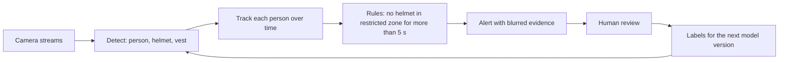
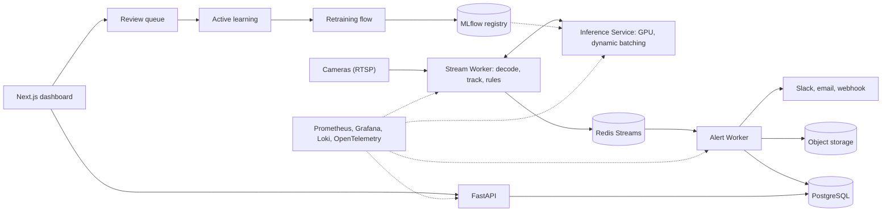

<div align="center">

# SiteGuard

### Real-time PPE and safety compliance for industrial and construction sites

Detect missing helmets and vests, track every worker, apply zone-and-duration rules, and send evidence-backed alerts, built the way product AI/ML teams build: **data to deployment, tested, monitored, and safe to roll back.**


<!-- Replace after Phase 10 -->
**Live demo:** _coming in Phase 10_ &nbsp;|&nbsp; **Blog post:** _coming in Phase 10_ &nbsp;|&nbsp; **Demo video:** _coming in Phase 10_

</div>

> **Honest status:** this repository is being built phase by phase. Right now the design, architecture, folder structure, Git strategy, CI/CD, ML pipeline, deployment and observability plans are written; code arrives phase by phase. Every feature below is tagged with the phase that delivers it, and every number in the results section is `TBD` until it is measured. Nothing here is claimed before it exists.

---

## Why this project exists

Factories and construction sites lose people, time and money to preventable accidents, and audits are slow and manual. Cameras are already installed, but nobody can watch every feed.

The hard part is not "detect a helmet". It is everything around it:

- **Not drowning safety officers in false alarms**, because they will ignore a system that cries wolf.
- **Counting one violation once**, not once per video frame.
- **Respecting workers' privacy**, since video of people is sensitive data.
- **Staying correct** when it gets dark, rains, a camera moves, or a new site opens.
- **Shipping model updates safely**, with the ability to undo them.

This project builds the whole system: dataset, models, tracking, rules, services, dashboard, pipelines, observability, cloud deployment, and the feedback loop that keeps it improving.

## What it does



| Capability | Phase |
|---|---|
| Unified, versioned, leakage-checked PPE dataset with your own footage as the golden test set | 1 |
| Baseline detector and an evaluation harness written from scratch (IoU variants, NMS, mAP) | 2 |
| Model comparison and tuning: YOLO vs Faster R-CNN vs RT-DETR, small-object handling, ablations, slice analysis | 3 |
| Multi-object tracking, deterministic rule engine, privacy-preserving evidence | 4 |
| ONNX, TensorRT FP16/INT8 with an accuracy-vs-latency table | 5 |
| Microservices: stream worker, GPU inference with dynamic batching, alert worker, API, dashboard, Docker Compose | 6 |
| ML tests, promotion gates, CI/CD pipelines, image scanning | 7 |
| Metrics, logs, traces, drift detection, active-learning and continuous-training loop | 8 |
| Terraform, Kubernetes, shadow and canary rollout, rollback, cost model | 9 |
| Public demo, model card, write-up, interview kit | 10 |

## Architecture at a glance



Full diagrams (runtime sequence, per-frame flow, state machine, ML lifecycle, data DAG, CI/CD/CT, deployment topology, contracts): **[docs/ARCHITECTURE.md](docs/ARCHITECTURE.md)**. Requirements, capacity math, trade-offs and failure modes: **[docs/DESIGN.md](docs/DESIGN.md)**.

## Key design decisions, in one line each

| Decision | Why |
|---|---|
| **ML for perception, deterministic rules for policy** | Rules are auditable and editable per site; compliance teams must know why an alert fired |
| **Split data by camera or site, never by random frame** | Neighboring frames are near-duplicates; random splits inflate every metric |
| **Own-footage golden set, frozen and hash-checked** | The only honest test of generalization to a camera the model has never seen |
| **Track first, then count violations** | One person without a helmet for 10 seconds is one violation, not 100 |
| **Central GPU inference service with dynamic batching** | Higher GPU utilization, independent scaling, trivial shadow mode |
| **Alert threshold chosen by cost of errors, not by default** | A missed violation and a false alarm have very different costs |
| **Two release trains: app and model** | Model improvements need no code deploy; code deploys never silently change the model |
| **Shadow, then canary, with automatic rollback** | ML failures are statistical; you need real traffic evidence before trusting a model |
| **Faces blurred before anything is stored** | Privacy by design, and no face recognition anywhere |

## Tech stack, and why each piece

| Layer | Tools | Why this, and when you would choose otherwise |
|---|---|---|
| Detection | YOLO family (baseline), Faster R-CNN, RT-DETR | Decided by ablation. Check licenses: some YOLO implementations are AGPL; Apache-licensed alternatives exist for commercial use |
| Auto-labeling | Grounding DINO, YOLO-World, SAM, CVAT | Pre-label then correct, cutting annotation time; humans stay the source of truth |
| Tracking | ByteTrack (Kalman + Hungarian) | Fixed cameras, no appearance model needed; DeepSORT/BoT-SORT for long occlusions |
| Training and tracking | PyTorch, MLflow, Optuna, DVC | Reproducible runs, searchable history, versioned data |
| Data quality | Pandera, cleanlab, perceptual hashing | Contracts, label-noise detection, near-duplicate detection |
| Export and speed | ONNX, ONNX Runtime, TensorRT | Portable artifact plus fastest NVIDIA runtime |
| Services | FastAPI, Redis Streams, PostgreSQL, MinIO/S3 | Simple, proven, fit the scale; swap Redis for Kafka only when replay and fan-out demand it |
| Dashboard | Next.js | Review queue and zone editing need a real UI |
| Orchestration | DVC pipeline, Prefect | Lightweight reproducibility and scheduled retraining |
| Observability | Prometheus, Grafana, Loki, OpenTelemetry, Evidently | Metrics, logs, traces and drift as code |
| CI/CD | GitHub Actions, Docker, Trivy | PR checks, image build and scan, staged deploys |
| Cloud | Terraform, Kubernetes, Argo Rollouts on GCP or Azure | Infrastructure as code, GPU node pools, canary analysis |

## Results

> Every cell is `TBD` until measured in the phase shown. Hardware is always stated, because latency means nothing without it.

| Metric | Value | Measured in |
|---|---|---|
| mAP@0.5 / mAP@0.5:0.95 (baseline, test) | TBD | Phase 2 |
| Best model mAP@0.5:0.95 (test and golden) | TBD | Phase 3 |
| Helmet and vest AP, small-object AP | TBD | Phase 3 |
| IDF1, ID switches | TBD | Phase 4 |
| False alerts per camera per day, missed-violation rate | TBD | Phase 4 |
| p50 / p95 / p99 latency, FPS (PyTorch FP32, ONNX, TensorRT FP16, INT8) | TBD | Phase 5 |
| End-to-end event latency, cameras per GPU | TBD | Phases 6 and 9 |
| Cost per 1,000 frames and per camera per month | TBD | Phase 9 |

Ablation table, error analysis, and a section on **what failed**: `docs/RESULTS.md`, `docs/EXPERIMENTS.md`, `docs/WHAT_FAILED.md`.

## Repository layout

```text
ppe-safety/
├── src/ppe/            library: data, training, evaluation, models, tracking, rules, export, observability
├── services/           deployable processes: api, stream_worker, inference, alert_worker, dashboard
├── configs/            YAML for data, training, evaluation, tracking, rules, export, serving, environments
├── pipelines/          orchestrated flows: data refresh, retraining, drift checks
├── monitoring/         Prometheus, Grafana, Loki, Alertmanager, OpenTelemetry configuration
├── deploy/ + infra/    Kubernetes manifests (Kustomize, Argo Rollouts) and Terraform
├── docker/             Compose files and base images
├── tests/              unit, data, model, integration, load
├── docs/               PRD, design, ADRs, runbooks, theory notes, model card, datasheet
├── scripts/            repo manifest and scaffolder, benchmarks, export, replay, promotion
├── notebooks/          exploration and Colab/Kaggle runners
├── annotation/         CVAT labeling setup
└── demo/               public demo app (Phase 10)
```

The complete tree with every file and the phase that creates it: **[docs/FOLDER_STRUCTURE.md](docs/FOLDER_STRUCTURE.md)**. 338 files across 11 phases, generated from a single manifest so the docs cannot drift from the plan.

## Quickstart

> Commands show the target experience and become available in the phase noted.

```bash
git clone https://github.com/<your-username>/ppe-safety && cd ppe-safety

make setup                   # Phase 0: venv, dependencies, pre-commit hooks
make test                    # Phase 0: lint, types, unit tests

dvc pull                     # Phase 1: fetch the versioned dataset
make train CONFIG=configs/train/baseline_yolo.yaml   # Phase 2: train and track a baseline
make evaluate                # Phase 2: metrics, PR curves, confusion matrix

make export                  # Phase 5: ONNX / TensorRT with parity check
make benchmark               # Phase 5: latency and throughput table

make up                      # Phase 6: full stack with Docker Compose
make replay VIDEO=sample.mp4 # Phase 6: loop a video as a fake RTSP camera
# open http://localhost:3000 for the dashboard

make up-obs                  # Phase 8: Prometheus, Grafana, Loki, traces
```

Training runs on Google Colab or Kaggle (notebooks provided); everything else runs locally with Docker.

## How this is built: phase by phase, learn by doing

| # | Phase | Outcome | Gate |
|---|---|---|---|
| 0 | Foundations and framing | Repo, PRD, CI skeleton | Fresh clone passes `make test` |
| 1 | Data engineering and annotation | `data-v1`, golden set | Leakage audit passes |
| 2 | Baseline and evaluation harness | First honest number | Own mAP equals reference |
| 3 | Model improvement | Ablation table, chosen model | Improvement explained by error analysis |
| 4 | Tracking, rules, privacy | Video to violation events | Business metrics measured |
| 5 | Optimization and export | Benchmark table | Latency budget met |
| 6 | Services and product surface | Working stack and dashboard | Fake camera gives exactly one alert |
| 7 | ML testing and CI/CD | Gated promotion | A worse model is rejected automatically |
| 8 | Observability and feedback loop | Dashboards, alerts, drift, retraining loop | Broken things trigger the right alerts |
| 9 | Cloud, Kubernetes, rollout | Staging and production from code | Bad model auto-rolled back |
| 10 | Launch | Demo, write-up, interview kit | A stranger understands it in minutes |

Each phase starts by listing **every file and folder it will create** (`python scripts/repo_manifest.py phase N`), scaffolding them, and only then building one file at a time, with a short concept explanation, a prediction, a from-scratch implementation, verification against a reference, and a reflection logged in the docs. Details: **[docs/ROADMAP.md](docs/ROADMAP.md)**.

## Engineering standards

- Typed, linted, tested Python in `src/`; thin entry points; interfaces at the seams that change.
- Everything config-driven and reproducible from **git SHA + data version + config + seed**.
- Numbers on everything: baseline, ablation table, latency percentiles, cost per 1,000 predictions, and an honest **what failed** log.
- CI on every pull request, a model gate on every candidate, canary on every release.
- Models, datasets and decisions each have a document: model card, datasheet, ADRs.

See **[docs/ENGINEERING_STANDARDS.md](docs/ENGINEERING_STANDARDS.md)**.

## Documentation map

| If you want to understand... | Read |
|---|---|
| What we are building and why | [docs/PRD.md](docs/PRD.md) |
| The system, scale and trade-offs | [docs/DESIGN.md](docs/DESIGN.md) |
| Components, flows, contracts | [docs/ARCHITECTURE.md](docs/ARCHITECTURE.md) |
| Every file and folder | [docs/FOLDER_STRUCTURE.md](docs/FOLDER_STRUCTURE.md), [docs/PHASE_MANIFEST.md](docs/PHASE_MANIFEST.md) |
| The build plan | [docs/ROADMAP.md](docs/ROADMAP.md) |
| Data to model, gates, continuous training | [docs/ML_PIPELINE.md](docs/ML_PIPELINE.md) |
| Branching, commits, versioning | [docs/GIT_STRATEGY.md](docs/GIT_STRATEGY.md) |
| CI, CD and CT pipelines | [docs/CICD.md](docs/CICD.md) |
| Docker, Kubernetes, cloud, rollout | [docs/DEPLOYMENT.md](docs/DEPLOYMENT.md) |
| Metrics, logs, traces, drift, alerts | [docs/OBSERVABILITY.md](docs/OBSERVABILITY.md) |
| Code quality, performance and testing rules | [docs/ENGINEERING_STANDARDS.md](docs/ENGINEERING_STANDARDS.md) |
| Decisions and their evidence | [docs/DECISIONS.md](docs/DECISIONS.md) |

## Limitations and responsible use

- **Not a safety guarantee.** It is an assistive monitoring tool. A human remains responsible for site safety, and missed detections will happen; the model card documents where.
- **Privacy.** The system never identifies people. Faces are blurred before storage, retention is bounded, and access to evidence is logged. Workplace monitoring is regulated differently across countries, so get legal advice and worker consultation before any real deployment.
- **Bias and coverage.** Performance differs by lighting, camera angle, clothing, PPE color and site type. Slice analysis and the model card report this openly.
- **Data licenses.** Each dataset has its own terms; see `docs/data/LICENSES.md`. Detector licensing also matters for commercial use.
- **Scope.** v1 covers helmets and vests on fixed cameras. Gloves, goggles, harnesses, re-identification across cameras and near-miss analytics are v2.

## Contributing

Work happens through short-lived branches and pull requests with Conventional Commits; see [CONTRIBUTING.md](CONTRIBUTING.md) and [docs/GIT_STRATEGY.md](docs/GIT_STRATEGY.md).

## License

To be chosen in Phase 0 (MIT or Apache-2.0 for the code; datasets and pretrained weights keep their own licenses).

## Acknowledgements

Public datasets and tools this project builds on, credited with their licenses in `docs/data/LICENSES.md`: SH17, Pictor-PPE, Roboflow Universe community datasets, CVAT, MLflow, DVC, Evidently, Prometheus, Grafana, and the open-source detection and tracking communities.
