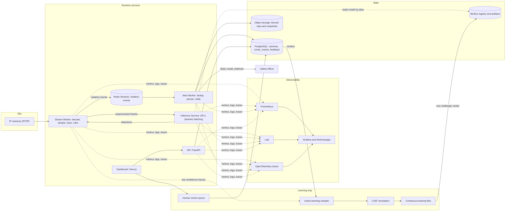
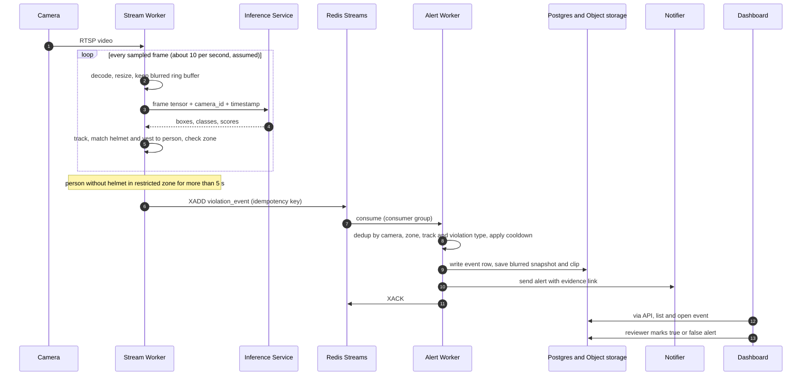
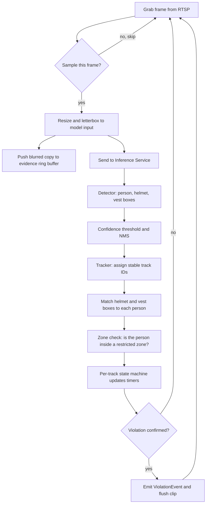
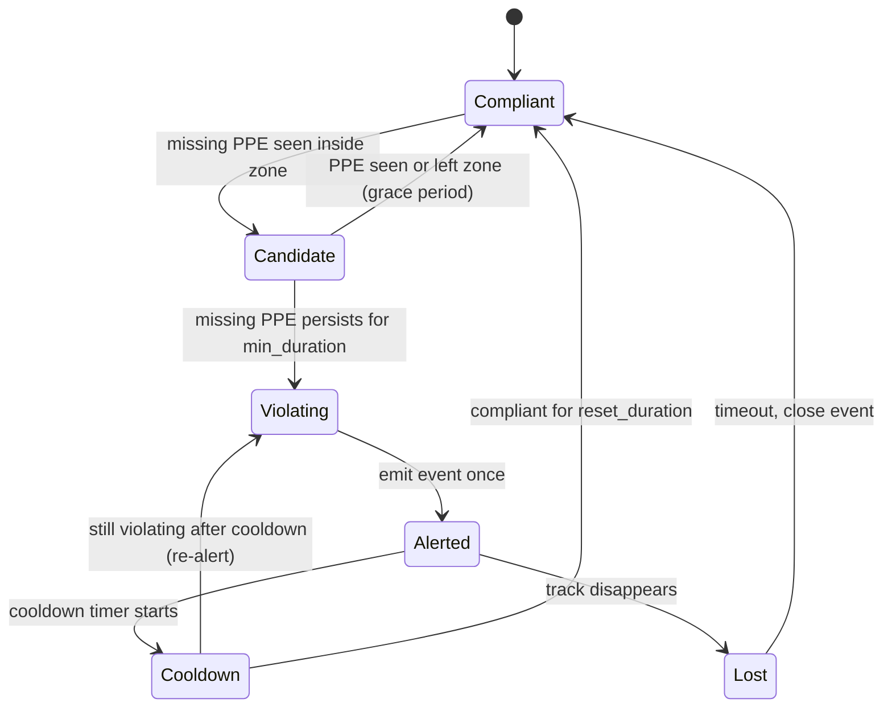
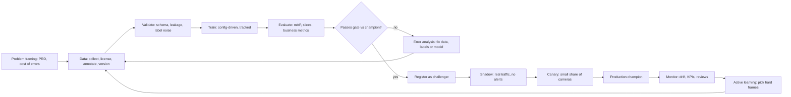
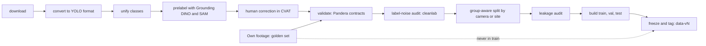
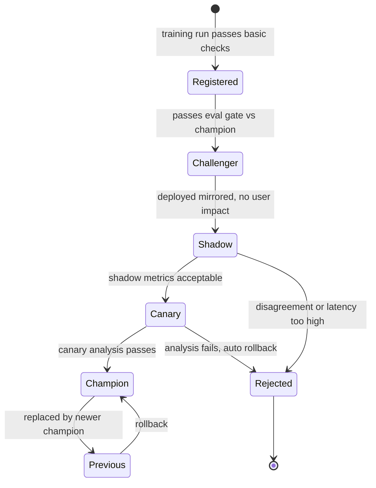
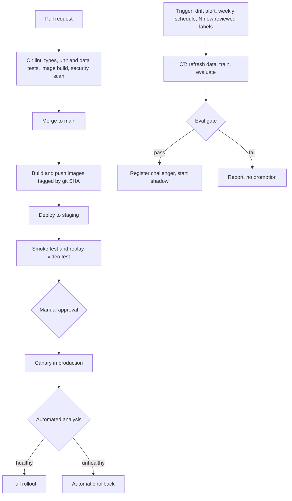
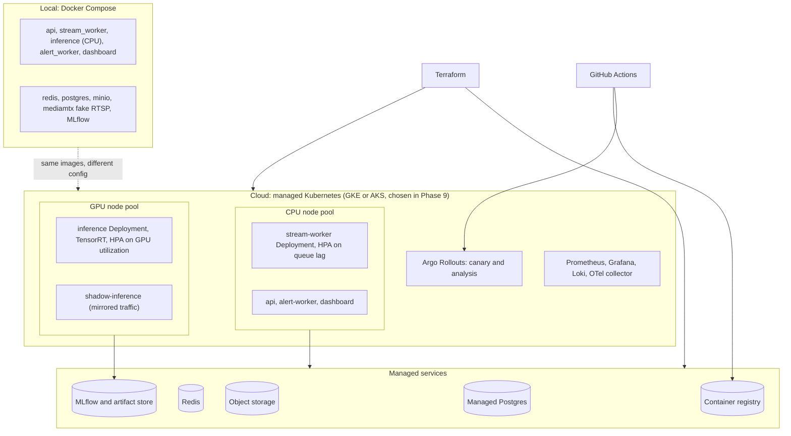
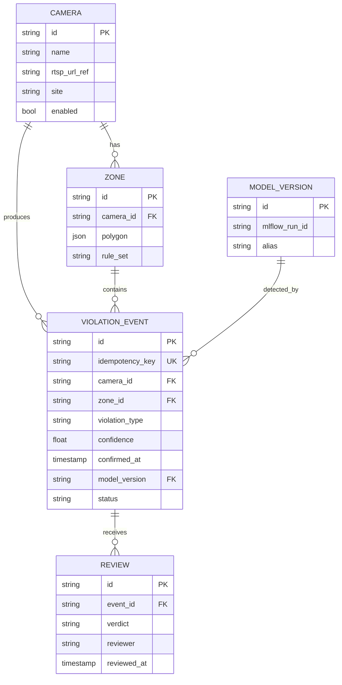

# Architecture

How the system is put together, how data and decisions flow through it, and how a model gets from an experiment to production. All diagrams are [Mermaid](https://mermaid.js.org/) and render on GitHub.

> Status: design baseline (Phase 0). Components are built phase by phase; see [ROADMAP.md](ROADMAP.md). Numbers marked *assumed* are hypotheses to be measured, not results.

**Contents**
1. [System at a glance](#1-system-at-a-glance)
2. [Runtime flow of one violation](#2-runtime-flow-of-one-violation)
3. [What happens to one frame](#3-what-happens-to-one-frame)
4. [Violation state machine](#4-violation-state-machine)
5. [ML lifecycle: the loop that makes it a product](#5-ml-lifecycle-the-loop-that-makes-it-a-product)
6. [Data pipeline DAG](#6-data-pipeline-dag)
7. [Model lifecycle and registry](#7-model-lifecycle-and-registry)
8. [CI / CD / CT overview](#8-ci--cd--ct-overview)
9. [Deployment topology](#9-deployment-topology)
10. [Contracts: events, tables, APIs, interfaces](#10-contracts)

---

## 1. System at a glance



**Reading the diagram**

| Piece | One-line job | Why it is its own component |
|---|---|---|
| Stream Worker | Pull a camera, decode, sample frames, track people, apply rules | CPU-bound, one per camera or small group; a crashing camera must not take down others |
| Inference Service | Run the detector on batches of frames from many cameras | Expensive GPU is shared; batching raises throughput; model can be swapped, shadowed or rolled back without touching workers |
| Redis Streams | Durable queue of violation events with consumer groups | Decouples detection speed from notification speed; survives alert-worker restarts |
| Alert Worker | Deduplicate, store evidence, notify | Slow, failure-prone I/O (Slack, email) is isolated from the real-time path |
| API + Dashboard | Configure cameras and zones, browse events, review alerts | Humans interact here; reviews become training labels |
| MLflow | Experiments, artifacts, model versions and aliases | Single place that says which model is `champion` |
| Learning loop | Reviews and low-confidence frames flow back to labeling and retraining | This loop is what separates a product from a one-off model |

---

## 2. Runtime flow of one violation



**Delivery guarantee.** At-least-once from the bus, made effectively-once by the idempotency key (`camera_id + track_id + violation_type + start_ts`) enforced by a unique constraint in Postgres. Retried messages never produce double alerts.

---

## 3. What happens to one frame



**Why each step exists**

| Step | Why | Alternative and when to prefer it |
|---|---|---|
| Frame sampling | Safety events last seconds; 10 FPS is enough and cuts GPU cost about 3x vs 30 FPS | Full FPS only if tracking breaks on fast motion |
| Letterbox resize | Keeps aspect ratio so boxes are not distorted | Stretch resize is faster but hurts accuracy on non-square frames |
| Blur before buffering | Privacy by design: unblurred faces never reach disk | Store raw only if legally required and access-controlled |
| NMS | Removes duplicate boxes for one object | NMS-free models (RT-DETR) skip it; Soft-NMS helps crowded scenes |
| Tracker | Turns per-frame boxes into per-person timelines so we count one violation, not 50 frames | Skip tracking only for single-frame audits |
| Deterministic rules | Auditable and configurable per site; compliance teams need to know why an alert fired | An ML classifier over tracks only if rules cannot express the policy |

---

## 4. Violation state machine

One instance per tracked person per violation type. Timers use frame timestamps, not wall-clock, so replays and tests are deterministic.



Design notes: a short **grace period** absorbs one-frame detector flicker; **cooldown** prevents alert floods; **Lost** handling stops a track-ID switch from creating a brand-new violation immediately (the dedup key in the Alert Worker is the second line of defense).

---

## 5. ML lifecycle: the loop that makes it a product



The two loops to remember: the **inner loop** (train, evaluate, error-analyze, fix data) runs daily during development; the **outer loop** (production, monitor, label, retrain) runs for the life of the product.

---

## 6. Data pipeline DAG

Implemented as a DVC pipeline (`dvc.yaml`), so `dvc repro` rebuilds only what changed.



---

## 7. Model lifecycle and registry

MLflow aliases (not the deprecated stages) mark where a model version is in its life.



Registered model name: `ppe-detector`. Aliases: `challenger`, `champion`, `previous`. Every version carries tags: `git_sha`, `data_version`, `config_path`, `seed`, `gate_report_uri`.

---

## 8. CI / CD / CT overview



Details and file-level breakdown: [CICD.md](CICD.md).

---

## 9. Deployment topology



Edge variant (documented, not built in v1): the same stream worker and an ONNX/TensorRT detector on a Jetson running Docker, publishing events to the cloud bus. TensorRT engines are built on the target device because they are tied to GPU architecture and TensorRT version.

---

## 10. Contracts

### 10.1 ViolationEvent (message on the `violations` stream)

```json
{
  "event_id": "01J8Z4M2Q7...",
  "idempotency_key": "cam-03:trk-182:no_helmet:2026-11-02T09:14:07Z",
  "camera_id": "cam-03",
  "zone_id": "zone-crane-radius",
  "violation_type": "no_helmet",
  "track_id": 182,
  "started_at": "2026-11-02T09:14:07Z",
  "confirmed_at": "2026-11-02T09:14:12Z",
  "duration_s": 5.2,
  "confidence": 0.87,
  "bbox_xyxy": [412, 188, 530, 460],
  "model": {"name": "ppe-detector", "version": "14", "alias": "champion"},
  "evidence": {"snapshot_uri": "s3://.../evt.jpg", "clip_uri": "s3://.../evt.mp4", "blurred": true},
  "schema_version": 1
}
```

### 10.2 Database tables (PostgreSQL)



RTSP credentials are never stored in the table; `rtsp_url_ref` points to the secret manager.

### 10.3 API surface (FastAPI, `/api/v1`)

| Method and path | Purpose |
|---|---|
| `GET/POST/PATCH /cameras` | Manage cameras |
| `GET/POST/PUT /cameras/{id}/zones` | Draw and edit restricted zones |
| `GET /events?camera=&type=&from=&to=&status=` | Query violations |
| `POST /events/{id}/ack` | Acknowledge an alert |
| `POST /events/{id}/review` | Reviewer verdict: `true_positive`, `false_positive`, `unsure` |
| `GET /review/queue` | Next items for human review (disputed and low-confidence first) |
| `GET /models/active` | Champion, challenger and shadow versions |
| `GET /healthz`, `GET /readyz` | Liveness and readiness |
| `GET /metrics` | Prometheus scrape endpoint |

### 10.4 Internal interfaces (Python `Protocol`s in `src/ppe`)

| Interface | Methods | Implementations |
|---|---|---|
| `Detector` | `predict(frames) -> list[list[Detection]]` | `YoloDetector`, `OnnxDetector`, `TrtDetector`, `SahiDetector`, `TritonClient` |
| `Tracker` | `update(detections, ts) -> list[Track]` | `ByteTracker` (and optionally DeepSORT) |
| `FrameSource` | `read() -> Frame` | RTSP capture, video file, replay |
| `Notifier` | `send(event) -> None` | Slack, webhook, email |
| `EventBus` | `publish(event)`, `consume(group)` | Redis Streams |

Programming against interfaces is what lets us swap YOLO for RT-DETR, or Redis for Kafka, by changing config and one class, not the pipeline.

### 10.5 Naming conventions

| Thing | Convention | Example |
|---|---|---|
| MLflow experiment | `ppe/<phase>` | `ppe/p3-ablations` |
| MLflow run | `<model>-<variant>-<imgsz>-<aug>` | `yolo11s-p2-960-aug2` |
| DVC dataset tag | `data-vN` | `data-v3` |
| App release tag | `vMAJOR.MINOR.PATCH` | `v0.6.0` |
| Image tag | git SHA and, on release, version | `ghcr.io/<user>/ppe-api:3f9c2ab` |
| Redis streams | `violations`, `violations.dlq` | |
| Prometheus metrics | `ppe_<component>_<name>_<unit>` | `ppe_inference_latency_seconds` |
