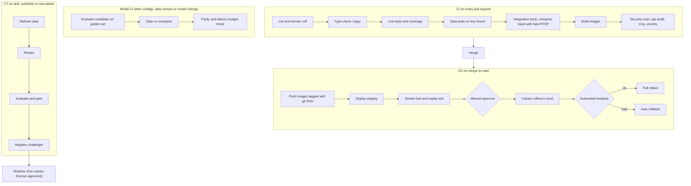

# CI / CD / CT

Three automated loops keep the system safe to change:

| Loop | Question it answers | Trigger | Output |
|---|---|---|---|
| **CI** (continuous integration) | Is this change correct and safe to merge? | Pull request | Green or red checks |
| **CD** (continuous delivery) | Can we ship it, and can we undo it? | Merge to `main` | Deployed, verified build |
| **CT** (continuous training) | Is the model still good, and is there a better one? | Drift, schedule, new labels | A gated challenger model with a report |

Workflow files are introduced phase by phase (see the `[P#]` tags). Phase 0 ships a minimal `ci.yml`; later phases grow it.

---

## 1. Pipeline map



---

## 2. CI: what runs and why

| Check | Tool | Why | Fails the PR when |
|---|---|---|---|
| Format and lint | `ruff format`, `ruff check` | One style, catches bugs early | Any violation |
| Type check | `mypy` (strict on `core`, `rules`, `tracking`, `evaluation`) | Types document interfaces and catch wiring errors | Type errors |
| Unit tests | `pytest` with coverage | Fast safety net for pure logic: IoU, NMS, zones, state machine | Failure, or coverage below the floor on core packages |
| Data tests | `pytest tests/data` on `tests/fixtures/` | Schema and label rules hold; no split leakage | Any contract break |
| Notebook hygiene | `nbstripout` check | Keeps outputs and secrets out of git | Notebook with outputs |
| Integration tests | `docker compose` + `mediamtx` fake camera | Proves stream to event to alert actually works | Any broken flow |
| Image build | Docker Buildx with cache | Catches broken Dockerfiles and missing deps | Build error |
| Security | `pip-audit`, `trivy`, `detect-secrets` | Vulnerable deps, leaked keys | High/critical findings |
| Docs check | link check, Mermaid lint (optional) | Docs stay true | Broken links |

Rules of thumb:

- **Fast feedback:** the required PR checks should finish in minutes. Slow jobs (integration, image scan) run in parallel and only on relevant path changes (`paths:` filters).
- **No GPU in CI.** CI never trains. It runs CPU-friendly tests and evaluates registered artifacts on the small golden set.
- **Cache** pip, Docker layers and DVC to keep runs short.

## 3. Model CI: the ML-specific part

Triggered when a PR touches `configs/train/`, `dvc.lock`, `params.yaml`, `configs/eval/gate.yaml` or registers a new candidate.

| Step | What | Output |
|---|---|---|
| 1 | Pull the candidate artifact from MLflow by run id (passed in the PR description or a workflow input) | weights, ONNX |
| 2 | Evaluate on the **golden set** (CPU is fine for a few hundred images) | metrics JSON |
| 3 | `check_eval_gate.py` compares against the champion report and `gate.yaml` | pass/fail with reasons |
| 4 | Parity check ONNX vs PyTorch, latency budget check from the recorded benchmark | report |
| 5 | Post a summary comment on the PR (tables, slice regressions) | PR comment |
| 6 | On merge and approval, `promote_model.py` moves alias `challenger` | registry updated |

Why train outside CI: training needs GPUs and hours. CI verifies **evidence** (reports, golden evaluation), it does not recreate the training run. In Phase 9, a `workflow_dispatch` job can launch a cloud GPU training job and wait for it.

## 4. CD: shipping safely

| Stage | Mechanism | Gate to continue |
|---|---|---|
| Build | `build-images.yml`: multi-stage Dockerfiles, non-root users, tag = git SHA, push to GHCR (later cloud registry) | Scan clean |
| Staging deploy | `cd-staging.yml`: apply Kustomize overlay or compose on a staging VM | Rollout healthy |
| Verification | `scripts/smoke_test.sh`: health endpoints, API CRUD, **replay a labeled clip through fake RTSP and assert the expected event** | Assertion passes |
| Approval | GitHub Environment `production` with required reviewer | Human click |
| Production canary | Argo Rollouts: 10% then 30% then 100% with pauses | Analysis passes at each step |
| Analysis | Prometheus queries: error rate, p95 latency, alert rate vs baseline, drop rate | Within thresholds |
| Rollback | Automatic on failed analysis; manual `rollback.sh` or `kubectl argo rollouts undo` | Verified by smoke test |

**Two separate release trains** (a key idea):

| Train | Changes | Rolled out by |
|---|---|---|
| Application | Code and images | Image tag via CD |
| Model | Weights | Registry alias change via shadow and canary |

They are independent so a model improvement never needs a code deploy, and a code change never silently changes the model.

## 5. CT: keeping the model fresh

| Trigger | Condition | Action |
|---|---|---|
| Drift | Drift report crosses threshold for a camera or globally | Open an issue; optionally start a retrain |
| Schedule | Weekly or monthly | Re-evaluate the champion on golden and fresh reviewed data |
| Labels | N new reviewer-confirmed corrections since the last dataset version | `data_refresh_flow` then `retrain_flow` |

Output is always a **challenger plus a report**; promotion needs a human approval, then shadow, then canary.

## 6. Environments and promotion

| Env | Purpose | Data | Deploy trigger |
|---|---|---|---|
| local | Development with Compose | fixtures, replayed clips | manual |
| staging | Integration and rehearsal | replayed real footage, synthetic cameras | every merge to `main` |
| production | Real users | live cameras | approved release with canary |

Config differs per environment in `configs/env/*.yaml` and Kustomize overlays; **images are identical across environments** (build once, deploy many).

## 7. Secrets and permissions

- GitHub Environments with required reviewers for production.
- Cloud access via OIDC federation (workload identity) rather than long-lived keys.
- Secrets only in GitHub Secrets or the cloud secret manager; `.env.example` lists names only.
- Least-privilege tokens; `permissions:` block set per workflow.
- Branch protection on `main` requires the CI checks.

## 8. Workflow files by phase

| Phase | File | Purpose |
|---|---|---|
| 0 | `.github/workflows/ci.yml` | lint, types, unit tests |
| 1 | `.github/workflows/data-ci.yml` | data contract checks on data-related PRs |
| 7 | `.github/workflows/model-ci.yml` | golden-set evaluation and gate |
| 7 | `.github/workflows/build-images.yml` | build, scan, push |
| 7 | `.github/workflows/cd-staging.yml` | staging deploy and smoke tests |
| 7 | `.github/workflows/security.yml` | dependency, image, secret scanning |
| 7 | `.github/dependabot.yml` | dependency update PRs |
| 8 | `.github/workflows/retrain.yml` | trigger CT pipeline |
| 9 | `.github/workflows/cd-prod.yml` | approval-gated canary deploy |

## 9. Example skeleton for `ci.yml` (Phase 0 version)

```yaml
name: ci
on:
  pull_request:
  push:
    branches: [main]

permissions:
  contents: read

concurrency:
  group: ci-${{ github.ref }}
  cancel-in-progress: true

jobs:
  checks:
    runs-on: ubuntu-latest
    steps:
      - uses: actions/checkout@v4
      - uses: actions/setup-python@v5
        with:
          python-version: "3.11"
          cache: pip
      - run: pip install -e ".[dev]"
      - run: ruff format --check .
      - run: ruff check .
      - run: mypy src
      - run: pytest -q --cov=src/ppe --cov-report=term-missing
```

We write and understand this file line by line in Phase 0 (learn by doing); later phases add jobs one at a time.

## 10. Definition of done for any change

- [ ] CI green
- [ ] Tests added or updated for behavior changes
- [ ] Docs and `CHANGELOG.md` updated when user-visible
- [ ] For model changes: MLflow run linked, gate report attached
- [ ] For config changes: reproducible run shown
- [ ] Rollback path known
