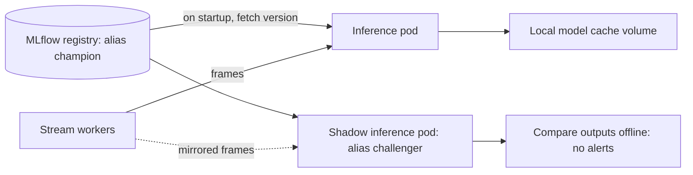

# Deployment

From `docker compose up` on a laptop to a managed Kubernetes cluster with canary rollouts, using the same images everywhere. Cloud-specific work is deferred to Phase 9 on purpose: you first learn the concepts locally, then map them to a provider.

> Free-credit offers, quotas and prices from cloud providers change often. Check current terms when you sign up, set a budget alert on day one, and tear down GPU resources when not in use.

---

## 1. Principles

| Principle | Meaning |
|---|---|
| Build once, deploy many | One image per service, identical in dev, staging and prod; only config changes |
| Config in environment, not in images | `configs/env/*.yaml`, environment variables, secret manager |
| Models are not baked into images | Services fetch the model by MLflow alias at startup, so model rollout is separate from app rollout |
| Everything as code | Compose, Kustomize, Terraform, dashboards, alert rules are all in the repo |
| Fail safe | Health probes, resource limits, graceful shutdown, automated rollback |
| Observable by default | Every service exposes `/metrics`, structured logs, trace context |

## 2. Environment ladder

| Env | How | Purpose | Phase |
|---|---|---|---|
| Local | Docker Compose, CPU inference or GPU if available, fake RTSP via MediaMTX | Daily development and integration tests | 6 |
| Staging | Single cloud VM with GPU, or a Kubernetes namespace | Rehearse deploys with replayed real footage | 9 |
| Production | Managed Kubernetes with CPU and GPU node pools | Live cameras | 9 |
| Edge (documented) | Jetson with Docker, events-only upload | Privacy-preferred or low-bandwidth sites | after v1 |

## 3. Docker

### 3.1 Images

| Image | Base | Contents | Notes |
|---|---|---|---|
| `ppe-base` | `python:3.11-slim` | Shared deps, `ppe` package | Pinned, non-root user |
| `ppe-train` | CUDA runtime image | PyTorch, Ultralytics, MLflow client, DVC | Mirrors Colab/Kaggle environment |
| `ppe-api` | `ppe-base` | FastAPI, SQLAlchemy, Alembic | CPU |
| `ppe-stream-worker` | `ppe-base` + FFmpeg/OpenCV | Decode, track, rules | CPU, scales per camera group |
| `ppe-inference` | CUDA + ONNX Runtime GPU or TensorRT runtime | Batcher and detector | GPU; CPU variant for local |
| `ppe-alert-worker` | `ppe-base` | Notifiers | CPU |
| `ppe-dashboard` | `node:lts` build, minimal runtime | Next.js standalone | |

### 3.2 Dockerfile rules

- Multi-stage builds: build in one stage, copy only the runtime into the final image.
- Pin base image versions (digest in production), pin Python dependencies via lock file.
- Run as non-root, read-only root filesystem where possible.
- `.dockerignore` excludes data, weights, `.git`, tests, notebooks.
- Order layers from least to most frequently changed to maximize cache hits.
- One process per container; health check defined.
- No secrets in layers or build args.

### 3.3 Compose (local)

`docker/docker-compose.yml` services:

| Service | Port | Depends on |
|---|---|---|
| `api` | 8000 | postgres, redis |
| `stream_worker` | none | redis, inference, mediamtx |
| `inference` | 8001 (gRPC/HTTP) | model volume or MLflow |
| `alert_worker` | none | redis, postgres, minio |
| `dashboard` | 3000 | api |
| `postgres` | 5432 | |
| `redis` | 6379 | |
| `minio` | 9000/9001 | |
| `mediamtx` | 8554 (RTSP) | fake camera via `scripts/replay_video.py` |
| `mlflow` (optional) | 5000 | |

Overlays: `docker-compose.dev.yml` (hot reload, mounted source), `docker-compose.obs.yml` (Prometheus, Grafana, Loki, OTel, Alertmanager). Commands live in the `Makefile`: `make up`, `make down`, `make logs`, `make replay`.

## 4. Model delivery



- Services resolve `models:/ppe-detector@champion` to a concrete version and log it with every event.
- TensorRT engines are **hardware- and version-specific**: build them per target GPU (at image start or in a build job), keep ONNX as the portable artifact.
- Warm-up on start (run a few dummy batches) before reporting ready, so the first real frames are not slow.

## 5. Kubernetes (Phase 9)

### 5.1 Layout

```text
deploy/k8s/
  base/        shared manifests (Deployments, Services, HPA, Ingress, NetworkPolicy)
  overlays/
    staging/   replicas, resources, hostnames for staging
    prod/      production sizing, stricter policies
  rollouts/    Argo Rollouts canary + analysis
  shadow/      shadow inference deployment
```

Kustomize first (plain YAML plus patches) because it makes the Kubernetes objects visible while you learn. Helm is the common alternative when you need templating and packaged releases.

### 5.2 Resources and why

| Object | Used for | Key settings |
|---|---|---|
| Deployment | api, stream-worker, inference, alert-worker, dashboard | Resource requests and limits; rolling update strategy |
| Rollout (Argo) | inference and api canary | Steps with pauses and analysis |
| Service | Stable internal addresses | ClusterIP; Ingress only for api and dashboard |
| Ingress + TLS | Public entry | cert-manager for certificates |
| HPA / KEDA | Autoscaling | stream-worker on queue lag; inference on GPU utilization or request queue (via custom metrics) |
| NodePools | Placement | CPU pool for workers; GPU pool for inference, tainted so only GPU pods land there |
| PodDisruptionBudget | Safe node maintenance | Keep at least one inference pod |
| Probes | Health | startup (model load), readiness (model ready), liveness (process alive) |
| NetworkPolicy | Security | Default deny; allow only needed paths |
| ConfigMap / Secret (external) | Config and credentials | Secrets from cloud secret manager via External Secrets |
| CronJob | Retention, scheduled drift checks | Runs the same images |

### 5.3 GPU specifics

- Install the NVIDIA device plugin; request `nvidia.com/gpu: 1`.
- Export GPU metrics with DCGM exporter to Prometheus.
- A GPU pod should hold one model server with internal batching; do not run many small pods per GPU without a sharing strategy (time-slicing or MIG where supported).
- Cost control: scale GPU pool to zero in staging outside working hours.

## 6. Cloud mapping: GCP or Azure

| Need | GCP | Azure |
|---|---|---|
| Managed Kubernetes | GKE | AKS |
| Container registry | Artifact Registry | Azure Container Registry |
| Object storage | Cloud Storage | Blob Storage |
| Managed Postgres | Cloud SQL | Azure Database for PostgreSQL |
| Redis | Memorystore | Azure Cache for Redis |
| Secrets | Secret Manager | Key Vault |
| GPU VMs for training | Compute Engine / Vertex AI | Azure ML / GPU VMs |
| CI-to-cloud auth | Workload Identity Federation | Federated credentials (OIDC) |
| Logs and metrics (optional managed) | Cloud Logging / Monitoring | Azure Monitor |

The architecture does not depend on either. Pick one in Phase 9 based on credits, GPU availability and what you want on your resume; the Terraform modules isolate the provider-specific parts.

## 7. Infrastructure as code (Terraform)

```text
infra/terraform/
  main.tf  variables.tf  outputs.tf  backend.tf
  modules/ network/  k8s_cluster/  registry/  storage/
  envs/    staging.tfvars  prod.tfvars
```

Rules: remote state with locking, one workspace or var-file per environment, `terraform plan` output posted on PRs, `apply` only from CI with approval, tags/labels on all resources for cost tracking.

## 8. Release strategies for models and apps

| Strategy | How it works | Protects against | Used for |
|---|---|---|---|
| **Shadow** | New model receives a copy of live frames; its outputs are logged and compared, never alerted | Bad models, with zero user impact | First step for every new model |
| **Canary** | A small share of cameras or traffic uses the new version; automated analysis decides promotion | Subtle regressions at real scale | Second step; app and model |
| **Blue-green** | Two full environments, switch traffic | Slow or risky app deploys | Pure app changes with schema care |
| **Feature flags** | Turn behavior on per camera or site | Unproven rules or thresholds | New rule types |
| **A/B test** | Split cameras into variants and compare business metrics | Choosing between two valid options | Threshold or workflow changes |

### 8.1 Shadow analysis

Compare champion and challenger on the same frames: agreement rate, per-class count differences, confidence distributions, latency, and a sample of disagreements reviewed by a human. Promote only if disagreements are explainable improvements, not regressions.

### 8.2 Canary analysis (automated, Argo Rollouts `AnalysisTemplate`)

| Metric (Prometheus) | Promote if |
|---|---|
| Inference error rate | Under threshold |
| p95 inference latency | Within budget |
| Frame drop rate | Not above baseline |
| Alerts per camera-hour | Within a band of the baseline (sudden jumps either way are suspicious) |
| Reviewer false-positive rate (delayed) | Not above baseline when enough reviews exist |

Steps: 10% then pause and analyze, 30% then pause, then 100%. Any failed analysis triggers automatic rollback.

### 8.3 Rollback

| What | Rollback action | Time |
|---|---|---|
| Model | Move alias `champion` back to `previous`; inference pods reload | minutes |
| App | Argo Rollouts `undo` or redeploy previous image tag | minutes |
| Config | Revert config commit; Kustomize apply | minutes |
| Database schema | Alembic downgrade only for backward-compatible migrations; design migrations expand-then-contract | planned |

Rollback must be **rehearsed in staging** (a Phase 9 exit gate), not just described.

## 9. Database migrations

- Alembic migrations in `services/api/alembic/`.
- Expand-then-contract: add new columns or tables first, deploy code that writes both, backfill, switch reads, remove old columns later. This makes every deploy rollback-safe.
- Migrations run as a Kubernetes Job before the new API rollout.

## 10. Cost and capacity management

| Practice | Detail |
|---|---|
| Budget alerts | Set on day one, at several thresholds |
| GPU time | Spot/preemptible for training; scale inference to demand; stop staging GPU after hours |
| Right-sizing | Use measured p95 latency and GPU utilization to choose instance types |
| Quantization | FP16/INT8 often lets one GPU serve far more cameras; fewer GPUs is the biggest saving |
| Frame policy | Lower sampling FPS for calm scenes |
| Storage | Lifecycle rules move or delete old evidence automatically |
| Reporting | `COST_MODEL.md`: cost per 1,000 frames, per camera per month, GPU vs CPU comparison |

## 11. Deployment checklists

**Before any production deploy**
- [ ] CI and model gate green
- [ ] Staging smoke and replay tests pass
- [ ] Rollback target identified (previous image tag, `previous` alias)
- [ ] Dashboards and alerts for the changed component exist
- [ ] Runbook updated if behavior changed
- [ ] Budget alert active

**After deploy**
- [ ] Canary analysis passed
- [ ] No spike in errors, latency, drops or alert volume
- [ ] Release tagged, `CHANGELOG.md` updated
