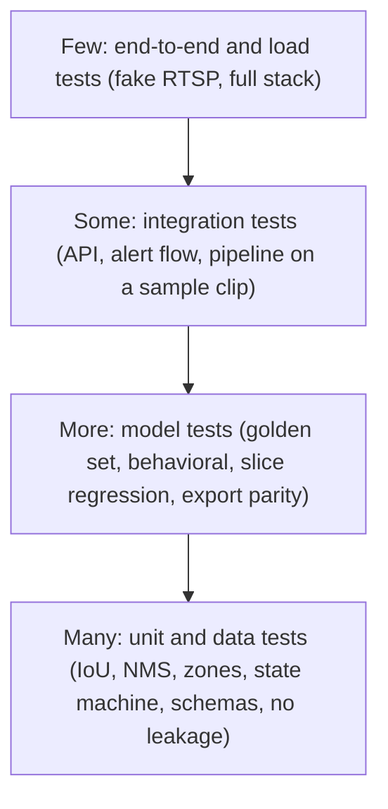

# Engineering Standards

The rules that make this a product codebase and not a notebook collection. They apply to every phase. Each rule says **what**, **why**, and **when it is fine to bend it**.

---

## 1. Code structure

| Rule | Why | Example |
|---|---|---|
| **Library in `src/ppe/`, entry points thin.** Scripts, services and notebooks call the library; they do not contain logic | One tested implementation serves research and production | `services/stream_worker/main.py` only wires config to `ppe.pipeline` |
| **Pure functions for decision logic.** Rules, IoU, NMS, thresholds take data in and return data out, with no I/O | Easy to test, reason about and replay | `rules/state_machine.py` takes `(state, observation, timestamp)` and returns a new state |
| **Interfaces (`Protocol`) at the seams that will change**: detector, tracker, notifier, frame source, event bus | Swap YOLO for RT-DETR or Redis for Kafka without touching the pipeline | `Detector.predict(frames)` |
| **Dependency direction:** `core` <- `data/evaluation/models/tracking/rules` <- `pipeline` <- `services`. Never the reverse | Prevents circular imports and hidden coupling | `rules` must not import `services` |
| **One responsibility per module**, short functions, no deep nesting | Readability | Split `evaluate.py` into metric computation and report rendering |
| **No premature abstraction.** Add an interface when a second implementation is real or planned in the roadmap | Over-engineering is also a bug | Notifier interface exists because three notifiers exist |
| **Config over constants.** Thresholds, paths, durations come from validated config | Behavior changes without code changes and runs are reproducible | `violations.yaml`, `configs/train/*.yaml` |

## 2. Style and typing

- Python 3.11, **ruff** for lint and format (single tool, fast), **mypy** with strict settings on core packages.
- Type hints on all public functions; dataclasses or pydantic models for structured data, never anonymous dicts passed around.
- Names say what things are, with **units and coordinate formats in names or types** where ambiguity bites: `bbox_xyxy_px`, `timeout_s`, `conf_threshold`. Mixing `xyxy`/`xywh` and pixel/normalized coordinates is the most common detection bug.
- Docstrings (Google style) on public functions: what it does, args with shapes/units, returns, raises. Add a **"Why"** line when the choice is non-obvious.
- Comments explain *why*, not *what*.
- No wildcard imports, no mutable default args, no bare `except:`.

## 3. Learn-by-doing code: the "from scratch, then library" pattern

For core concepts we implement the idea ourselves, test it against a trusted library, then use the library in production.

| Concept | We write | We compare with | Production uses |
|---|---|---|---|
| IoU, GIoU, DIoU, CIoU | `evaluation/iou.py` | `torchvision.ops` | Library inside training; ours for evaluation understanding |
| NMS / Soft-NMS | `evaluation/nms.py` | `torchvision.ops.nms` | Library or model-integrated |
| AP / mAP | `evaluation/metrics.py` | `pycocotools` | Reference library as the source of truth, ours verified against it |
| Kalman filter, Hungarian matching | `tracking/kalman.py`, `association.py` | ByteTrack reference | Chosen after comparison |
| Dynamic batching | `services/inference/batcher.py` | Triton | Chosen by measurement |

Why: writing it once makes you able to debug it, explain it in interviews and spot when a library default is wrong for your data.

## 4. Error handling and robustness

- Define domain exceptions in `core/exceptions.py`; catch narrowly and only where you can act.
- **Fail fast on invalid config** at startup (pydantic validation), not in the middle of a stream.
- Network calls always have **timeouts, bounded retries with backoff and jitter**; poison messages go to a dead-letter stream.
- Resource cleanup via context managers (`with`) for captures, files and connections.
- Streams are long-running: no unbounded lists or caches; every queue has a maximum size.
- Log at boundaries (start, stop, state change), not inside hot loops.

## 5. Performance rules

**Measure first.** Profile before optimizing (`cProfile`, `py-spy`, PyTorch profiler, NVIDIA Nsight when on GPU). Record before/after numbers in the PR.

| Area | Guidelines |
|---|---|
| Python hot paths | Vectorize with NumPy/PyTorch; avoid per-box Python loops where arrays work; preallocate buffers; avoid copies (`np.ascontiguousarray` only when needed) |
| Video | Decode once; downscale early; use hardware decode where available; sample frames instead of processing all |
| Inference | Batch across cameras; FP16 or INT8 after parity checks; keep tensors on GPU between preprocess, model and postprocess where possible; warm up the model; pin memory for transfers |
| I/O | Async I/O for network and storage in services; never block the frame loop on a notifier or database write |
| Memory | Bounded ring buffers for evidence; stream clips to disk instead of holding long videos in RAM |
| Concurrency | Processes for CPU-bound decode (avoid the GIL), threads/async for I/O; single-writer patterns for shared state |
| Algorithms | Prefer O(n log n) or vectorized matching; use the Hungarian algorithm only on the active track set |

When **not** to optimize: code outside the frame loop (config loading, report generation), or when the profile says it is under a few percent of time.

## 6. Testing: the ML testing pyramid

| Test type | Folder | Examples | Runs |
|---|---|---|---|
| Unit | `tests/unit/` | IoU against known values; state machine timer edge cases; zone geometry; config validation | Every PR, seconds |
| Data | `tests/data/` | Schema, label ranges, no cross-split groups, golden set hash | Every data PR |
| Model | `tests/model/` | Golden-set regression; **behavioral** tests (invariance: brightness/blur small changes should not flip the label; directional: removing a helmet should flip it); slice regression; export parity | Model CI |
| Integration | `tests/integration/` | Offline pipeline on a clip; API contracts; event to alert flow | Every PR (CPU) |
| Load | `tests/load/` | Locust against staging: p50/p95/p99 vs camera count | Before releases |

Rules:
- **Test the logic that can silently be wrong**: coordinate conversions, thresholds, timers, deduplication, leakage.
- Deterministic tests: fixed seeds, frame timestamps instead of wall-clock time.
- Use property-based tests (Hypothesis) for geometry and IoU invariants (symmetry, range 0 to 1, identical boxes give 1).
- Coverage is a smoke alarm, not a goal: require a floor on `core`, `rules`, `tracking`, `evaluation`; do not chase 100%.
- A bug fix starts with a failing test.

## 7. Reproducibility

Same as the ML pipeline checklist: pinned dependencies (lock file), seeds, committed configs, data version, environment capture. Notebooks must run top to bottom from a clean runtime; anything reusable moves to `src/`.

## 8. Dependencies and security

- Pin direct dependencies; use a lock file; update through Dependabot PRs.
- Minimal dependencies in runtime images (no training libraries in the API image).
- Scan: `pip-audit`, `trivy`, `detect-secrets`. No secrets in code, notebooks, images or logs.
- Check licenses of dependencies, datasets and pretrained weights before use and record them (`docs/data/LICENSES.md`).

## 9. Documentation standards

| Artifact | Rule |
|---|---|
| README | Answers what, why, how to run, how it was built, with real numbers once they exist |
| ADR | Every significant choice: context, options, decision, consequences. Written when decided, with evidence |
| `EXPERIMENTS.md` | One row per meaningful run, linked to MLflow |
| `WHAT_FAILED.md` | Write failures the same day; they are the most interesting part of the write-up |
| Model card | Intended use, data, metrics by slice, limitations, failure modes, ethical considerations |
| Datasheet | Dataset composition, collection, labeling process, biases and limits |
| Runbooks | One per alert, tested in staging |
| Docs rot guard | Generated docs (`FOLDER_STRUCTURE.md`, `PHASE_MANIFEST.md`) come from `repo_manifest.py`; CI regenerates and fails on diff |

## 10. Definition of done (per task)

- [ ] Code typed, linted, formatted; no TODOs without an issue
- [ ] Tests written first or alongside; all green in CI
- [ ] Config-driven; no magic numbers
- [ ] Logged or measured where behavior matters
- [ ] Docs updated (docstring, relevant doc, `CHANGELOG.md` if user-visible)
- [ ] You can explain **why** it was built this way and **when you would choose something else**

## 11. Review checklist for detection code

- [ ] Coordinates: format (`xyxy`/`xywh`), scale (pixels/normalized), image size used for conversion
- [ ] Confidence threshold and NMS IoU threshold come from config
- [ ] Evaluation uses the correct split and never the golden set for tuning
- [ ] Class ids mapped through the unified class map
- [ ] Batch and single-image paths give the same results
- [ ] Timers use frame timestamps
- [ ] No unbounded growth in memory per camera
