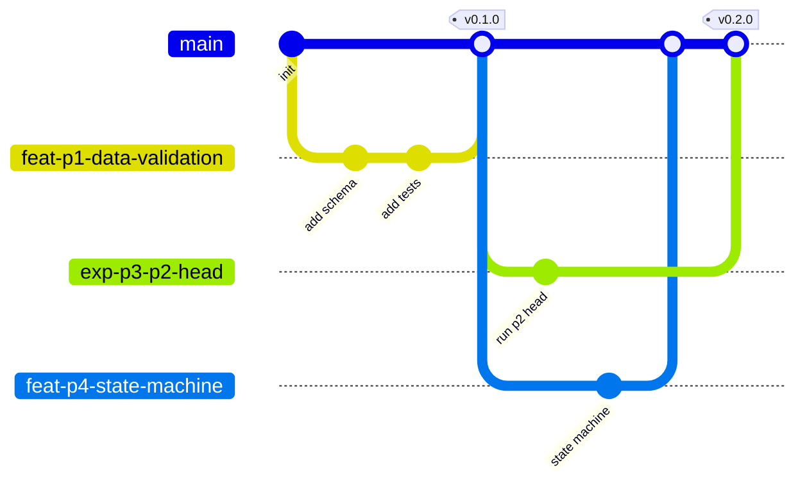
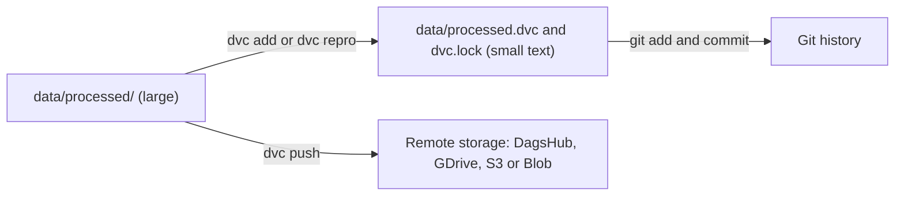

# Git Strategy

How we use Git so that history is readable, `main` is always deployable, and every model can be traced to the exact code, data and config that produced it. Even as a solo builder we work through pull requests: CI acts as the reviewer, and the habit is what interviewers and teams expect.

---

## 1. Model: trunk-based development



*(Branch names in the diagram use hyphens only because some Mermaid versions mishandle slashes; real branches use the `type/topic` names below.)*

| Rule | Why |
|---|---|
| `main` is always green and deployable | Anyone can release at any time |
| Short-lived branches (hours to a few days) | Small diffs are easy to review and rarely conflict |
| Squash-merge pull requests | One clean commit per change; the PR holds the detail |
| No direct pushes to `main` | Branch protection enforces CI |
| One PR = one task from the phase checklist | Maps the roadmap to history |

Why not GitFlow (long-lived `develop` and `release` branches)? It suits boxed release cycles. A continuously deployed service with feature flags and gated model rollout is simpler and safer with trunk-based development.

## 2. Branch naming

| Prefix | Use | Example |
|---|---|---|
| `feat/p<phase>-<topic>` | New capability | `feat/p2-iou-from-scratch` |
| `fix/<topic>` | Bug fix | `fix/state-machine-timer-reset` |
| `exp/p<phase>-<idea>` | Experiments that may be discarded | `exp/p3-focal-loss` |
| `docs/<topic>` | Documentation only | `docs/privacy-section` |
| `chore/<topic>` | Tooling, deps, CI | `chore/bump-ruff` |
| `hotfix/<topic>` | Urgent production fix | `hotfix/dedup-key` |

Experiment branches are valuable even when abandoned: merge the **log entry** (`EXPERIMENTS.md`, `WHAT_FAILED.md`) and delete the code if it did not help.

## 3. Commit messages: Conventional Commits

```
<type>(<scope>): <summary in imperative mood>

<why this change, not what; wrap at about 72 chars>

Refs: #12, MLflow run 3a9f...
```

| Type | Meaning |
|---|---|
| `feat` | New feature |
| `fix` | Bug fix |
| `perf` | Performance improvement |
| `refactor` | No behavior change |
| `test` | Tests only |
| `docs` | Docs only |
| `build`, `ci`, `chore` | Tooling, pipelines, housekeeping |
| `data` | Dataset or label pipeline change |
| `model` | Training config or model change |

Scopes mirror folders: `data`, `training`, `evaluation`, `tracking`, `rules`, `export`, `api`, `worker`, `inference`, `dashboard`, `infra`, `monitoring`.

Examples:
- `feat(evaluation): implement CIoU from scratch with reference tests`
- `fix(rules): reset violation timer when person leaves zone`
- `data(split): split by camera id to prevent frame leakage`
- `model(training): add P2 head variant at 960 px`

Benefits: readable history, automatic changelog and version bumps, easy `git log --grep`.

## 4. Pull requests

`.github/pull_request_template.md` (Phase 0):

```markdown
## What and why
## Phase / task
## How I tested it
## ML checklist (delete if not applicable)
- [ ] No data leakage introduced (splits by group)
- [ ] Seeds fixed, config committed
- [ ] MLflow run linked: 
- [ ] Metrics compared to baseline / champion
- [ ] Slice metrics checked
- [ ] Model card / DATASET_CHANGELOG updated
## Risks and rollback
```

Review focus for ML code (even self-review): leakage, evaluation on the right split, units and coordinate formats (xyxy vs xywh, normalized vs pixels), seeds, config vs hardcoded values, and whether a metric improvement is real or noise.

## 5. Protection and automation

| Setting | Value |
|---|---|
| Branch protection on `main` | Require PR, require CI checks, no force-push, linear history |
| Required checks | `ci`, `data-ci` (when relevant), later `model-ci`, `security` |
| `CODEOWNERS` | Paths like `src/ppe/rules/`, `deploy/`, `infra/` need owner review |
| Pre-commit hooks | ruff, mypy (fast subset), detect-secrets, nbstripout, end-of-file-fixer |
| Signed commits | Optional; recommended for infra and release tags |
| Dependabot | Weekly dependency PRs, grouped |

## 6. Tags and releases

| Tag | Meaning | Created by |
|---|---|---|
| `vMAJOR.MINOR.PATCH` | Application release (SemVer) | Release PR merge |
| `data-vN` | Frozen dataset version (matches DVC state and `DATASET_CHANGELOG.md`) | Data PR merge |
| `model-<registry version>` | Model version promoted to `challenger` or `champion` | `promote_model.py` |

SemVer here: **MAJOR** breaking API or event schema change, **MINOR** new capability, **PATCH** fixes. Event and API schemas carry their own `schema_version` so consumers can handle old and new.

Release flow: update `CHANGELOG.md`, bump `version.py`, merge release PR, tag, CI builds and pushes images, CD deploys through staging to production.

## 7. Large files: DVC, not Git



| Thing | Where it lives |
|---|---|
| Code, configs, docs, `.dvc` pointers, `dvc.lock` | Git |
| Datasets, model weights, large artifacts | DVC remote or MLflow artifact store |
| Experiment runs | MLflow (linked by run id in PRs and tags) |
| Secrets | Never in Git |

Daily data workflow:

```bash
git switch -c data/p1-add-site-b-footage
dvc add data/raw/site_b          # or update via dvc repro
git add data/raw/site_b.dvc .gitignore
git commit -m "data(raw): add site B footage"
dvc push                         # upload the actual files
git push -u origin HEAD          # open a PR
```

Rule: **never commit before `dvc push`** for data changes, or teammates (and CI) will see pointers to files that do not exist.

Notebooks: strip outputs with `nbstripout`; notebooks are for exploration, and anything reusable moves to `src/ppe/`.

## 8. Everyday command cheat sheet

```bash
git switch -c feat/p2-iou-from-scratch     # start a task
git add -p                                  # stage deliberately
git commit                                  # conventional message
git fetch origin && git rebase origin/main  # stay current, linear history
git push -u origin HEAD                     # open PR
# after merge
git switch main && git pull --ff-only && git branch -d feat/p2-iou-from-scratch
```

Undo options: `git restore <file>` (discard working changes), `git revert <sha>` (safe undo on shared history), `git reflog` (find lost commits). Avoid `reset --hard` and force-push on shared branches.

## 9. Hotfix and rollback

| Situation | Action |
|---|---|
| Bad app release | Roll back the deployment (image tag) first; then revert the commit via PR |
| Bad model | Move the `champion` alias to `previous` (no code deploy); investigate afterwards |
| Bad data version | Check out the previous `data-vN` tag, `dvc checkout`, retrain or re-gate |
| Leaked secret | Rotate the secret immediately, then remove from history; assume compromised |

## 10. Traceability: from a prediction back to its causes

```text
Alert in dashboard
  -> model version (event.model.version)
    -> MLflow run
      -> tags: git_sha, data_version, config_path, seed
        -> git commit, data-vN tag, config file
```

Any alert can be traced to the exact code, data and configuration that produced the model behind it. This is the property auditors and incident reviews rely on.
