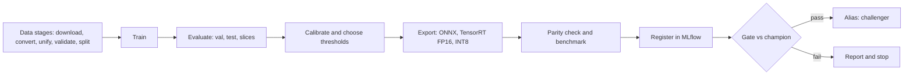
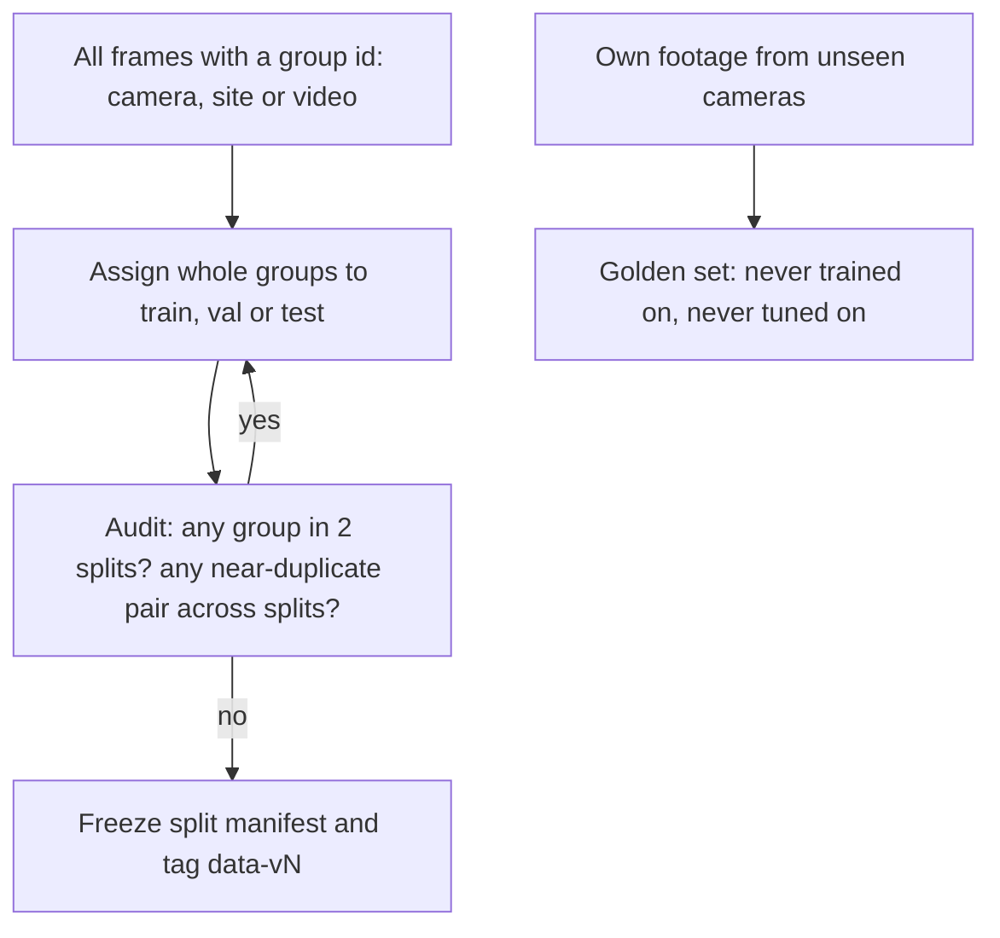
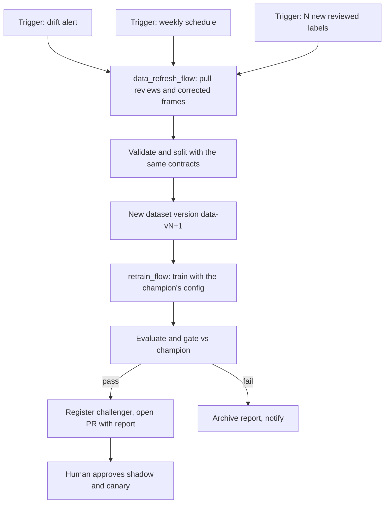

# ML Pipeline

How raw data becomes a registered, gated, deployable model, and how production feedback turns into the next model. Everything here is reproducible from **git SHA + data version + config + seed**.

> Training runs on Colab, Kaggle or a cloud GPU. The pipeline is the same everywhere because it is driven by config files and DVC stages, not by notebook state.

---

## 1. Pipeline at a glance

## 2. Stages, inputs, outputs and checks

DVC stage names match `dvc.yaml`. Each stage is a pure function of its inputs, so DVC can skip it when nothing changed.

| # | DVC stage | Code | Inputs | Outputs | Checks that must pass |
|---|---|---|---|---|---|
| 1 | `download` | `data/download.py` | `configs/data/dataset.yaml` | `data/raw/` | Checksums match; license recorded |
| 2 | `convert` | `data/convert.py` | `data/raw/` | `data/interim/yolo/` | Every image has a label file or is flagged as background |
| 3 | `unify` | `data/unify_classes.py` | `classes.yaml`, interim | unified labels, drop report | No unmapped class silently dropped |
| 4 | `prelabel` (optional) | `data/prelabel.py` | unlabeled frames | draft labels | Draft stays separate until human-reviewed |
| 5 | `validate` | `data/validate.py` | unified labels | validation report | Pandera contract: boxes in [0,1], valid ids, no corrupt or zero-area boxes |
| 6 | `noise_audit` | `data/label_noise.py` | labels + model predictions | suspect-label list | Reviewed; fixes applied or waived in changelog |
| 7 | `split` | `data/split.py` | validated labels, `splits.yaml` | `train/val/test` manifests | **No group in two splits** |
| 8 | `leakage_audit` | `data/leakage_audit.py` | split manifests | audit report | No cross-split near-duplicates (perceptual hash / embedding) |
| 9 | `build_dataset` | `data/` | manifests | `data/processed/` | Class counts and size stats logged |
| 10 | `train` | `training/train.py` | processed data, `configs/train/*.yaml` | weights, MLflow run | Loss finite; seed fixed; config logged |
| 11 | `evaluate` | `evaluation/evaluate.py` | weights, val/test | metrics JSON, plots | Metrics match reference implementation in tests |
| 12 | `slices` | `evaluation/slices.py` | predictions | per-slice table | Every critical slice has enough samples |
| 13 | `thresholds` | `evaluation/thresholds.py` | val predictions, costs | threshold per class/camera | Meets false-alert cap |
| 14 | `export` | `export/to_onnx.py`, `to_tensorrt.py` | weights | ONNX, engine | Opens and runs |
| 15 | `parity` | `export/parity_check.py` | PyTorch + exported | parity report | Output difference and mAP delta within tolerance |
| 16 | `benchmark` | `scripts/benchmark_latency.py` | exported model | latency table | p95 within budget on target hardware |
| 17 | `register` | `training/tracking.py` | all of the above | MLflow model version | Required tags present |
| 18 | `gate` | `evaluation/gate.py` | candidate and champion reports | pass/fail + gate report | See section 6 |

Run: `dvc repro` (everything changed), `dvc repro train` (one stage), `dvc dag` (see the graph).

## 3. Data contracts (what "valid data" means)

Written as Pandera schemas and tested in CI on the tiny fixture dataset:

- Image readable, minimum size, no duplicate file hashes within or across splits.
- Each box: `0 <= x,y <= 1`, `w,h > 0`, area above a minimum, class id in the class map.
- No more than a configured fraction of images without any label (background images are allowed, but intentional).
- Per-class counts within expected ranges; sudden changes between dataset versions require a changelog entry.
- Split manifests: disjoint groups (camera/site/video ids).

## 4. Splits and leakage: the rule that protects every number

Why: consecutive video frames are almost identical. Randomly splitting frames puts near-copies in train and test, so the model is graded on memorization and mAP looks great until deployment. Splitting by group measures generalization to a camera or site it has never seen, which is what production is.

## 5. Experiment tracking conventions

| Item | Convention |
|---|---|
| Tracking server | MLflow. During Colab/Kaggle phases use a hosted MLflow (for example DagsHub) or local files synced out; migrate to a self-hosted server on the cloud in Phase 9 |
| Experiment | `ppe/<phase>` e.g. `ppe/p3-ablations` |
| Run name | `<model>-<variant>-<imgsz>-<aug>` e.g. `yolo11s-p2-960-aug2` |
| Always logged params | everything in the config file, plus `seed`, `git_sha`, `data_version`, `config_path`, `gpu_name`, `library_versions` |
| Always logged metrics | per-epoch losses; final mAP50, mAP50-95, per-class AP; per-slice AP; latency p50/p95 when exported |
| Always logged artifacts | best weights, config copy, PR curves, confusion matrix, error-analysis samples, environment file |
| Reproducibility | `set_seed` for Python, NumPy, PyTorch; deterministic flags where feasible; document where full determinism is impossible (some GPU kernels) |
| Human log | One row per meaningful run in `docs/EXPERIMENTS.md`; every failed idea in `docs/WHAT_FAILED.md` |

## 6. Evaluation protocol and the promotion gate

| Split | Used for | Rule |
|---|---|---|
| train | fitting | |
| val | model selection, threshold choice, early stopping | May be used repeatedly |
| test | final unbiased estimate | Report **once** per candidate family |
| golden | gate and regression | Read-only, hash-checked, never used to tune |

A candidate becomes `challenger` only if **all** hold (numbers live in `configs/eval/gate.yaml`):

1. No regression on golden mAP@0.5:0.95 beyond tolerance versus the champion.
2. Recall on `no_helmet` and `no_vest` meets the PRD target at the chosen threshold.
3. No critical slice regresses by more than the allowed margin.
4. False alerts per camera per day (replay on labeled video) under the cap.
5. Export parity within tolerance and p95 latency within budget on the target hardware.
6. Model card and gate report attached to the registered version.

The first model has no champion, so it is gated against the PRD targets only.

## 7. Model registry

- Registered model: `ppe-detector`.
- Aliases: `challenger`, `champion`, `previous`.
- Services load by alias at startup (`models/registry.py`), so promotion and rollback are alias moves, not redeploys of application code.
- Each version has tags: `git_sha`, `data_version`, `config_path`, `seed`, `gate_report_uri`, `onnx_uri`, `tensorrt_engine_hardware`.

## 8. Ablation plan (fill as Phase 3 runs)

One variable at a time against the baseline. Every row is a tracked run.

| Axis | Variants | Hypothesis |
|---|---|---|
| Model family | YOLO small, Faster R-CNN, RT-DETR | YOLO best accuracy per millisecond |
| Input resolution | 640, 960, 1280 | Helmets at distance need more pixels |
| Small-object head | none, P2 head | P2 lifts small-object AP |
| Augmentation | none, standard, standard + copy-paste, + weather/low-light | Low-light and weather augmentation reduce the night gap |
| Pretraining | COCO-pretrained, from scratch | Pretrained wins strongly at this data size |
| Data | + pre-labeled-and-corrected data, + synthetic data, - noisy labels | Cleaner labels beat more noisy labels |
| Loss/sampling | default, focal, class-balanced sampling | Matters only if imbalance hurts rare classes |
| Distillation | large teacher into small student | Student recovers most of the large model's accuracy |

Result table template:

| Run | mAP50 | mAP50-95 | helmet AP | vest AP | small-object AP | p95 latency | Notes |
|---|---|---|---|---|---|---|---|
| baseline | | | | | | | |

## 9. Continuous training (CT)

Rules: CT never promotes straight to production. It produces a **challenger with a report**, and a human approves rollout stages. Retraining uses the same code and contracts as manual runs.

## 10. Active learning loop

| Step | What | Where |
|---|---|---|
| 1 | Log low-confidence frames, reviewer-disputed alerts, and a small random sample for unbiased monitoring | `active_learning/sampler.py` |
| 2 | Deduplicate near-identical frames, cap per camera, balance by condition | same |
| 3 | Export to CVAT, pre-filled with the model's boxes | `export_to_cvat.py` |
| 4 | Human corrects; agreement spot-checks | CVAT |
| 5 | Ingest into the next dataset version with changelog entry | `feedback_ingest.py` |

The random sample matters: if we only label hard frames, our metrics become biased. Keep a steady unbiased stream for honest monitoring.

## 11. Reproducibility checklist (per run)

- [ ] Code at a clean git SHA, recorded in MLflow
- [ ] Data version tag recorded
- [ ] Config file committed, not edited in notebook cells
- [ ] Seeds set and logged
- [ ] Environment captured (`pip freeze` or lock file, CUDA, GPU name)
- [ ] Metrics, plots and weights logged as artifacts
- [ ] Run summarized in `EXPERIMENTS.md`; failures in `WHAT_FAILED.md`

## 12. Colab and Kaggle practicalities

Sessions disconnect and limits change, so treat compute as preemptible:

- Save checkpoints every epoch to persistent storage (Drive, Kaggle dataset output, or object storage) and support `resume`.
- Never rely on local `/content` state; the notebook only clones the repo, installs, pulls data via DVC, and runs `python -m ppe.training.train --config ...`.
- Log to MLflow from the first epoch, not at the end.
- GPU type and quotas vary; record the GPU name in every run, because latency numbers are only meaningful per hardware.
