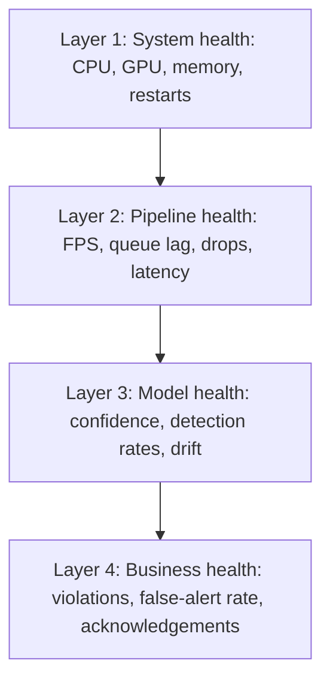
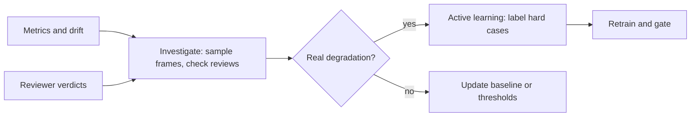

# Observability and Monitoring

The goal: at any moment, answer **"Is it working, is it correct, and is it worth what it costs?"** without logging into a machine. Software observability tells you the system is running; ML observability tells you the predictions are still right. A PPE system can be perfectly healthy as software while silently missing helmets at night, so we monitor both.

---

## 1. The four layers



| Layer | Question | Examples | Ground truth needed? |
|---|---|---|---|
| System | Are machines and containers OK? | GPU utilization, memory, pod restarts | No |
| Pipeline | Is data flowing on time? | Frames per second per camera, queue lag, dropped frames, p95 latency | No |
| Model | Does the model behave as before? | Confidence distribution, detections per frame by class, per-camera detection rate, drift scores | No (proxies) |
| Business | Is it useful and trusted? | Alerts per day, reviewer false-positive rate, time to acknowledge | Partly (reviews arrive late) |

**Key ML idea: labels are delayed.** We rarely know in real time whether a prediction was right. So we monitor proxies (distributions, rates) immediately, and true quality later from reviewer verdicts, scheduled audits and the golden set.

## 2. Stack

| Concern | Tool | Why |
|---|---|---|
| Metrics | Prometheus (+ `prometheus-client` in each service) | Standard pull-based metrics and alert rules |
| GPU metrics | NVIDIA DCGM exporter | Utilization, memory, temperature in Prometheus |
| Dashboards | Grafana (provisioned from files) | Dashboards as code |
| Logs | Structured JSON via `structlog` to Loki (Promtail ships) | Searchable, correlated with traces |
| Traces | OpenTelemetry SDK and Collector | Follow one frame or event across services |
| Alert routing | Alertmanager | Grouping, silencing, severity routing |
| Drift and data quality | Evidently reports, run by a scheduled Prefect flow | Reproducible reports and thresholds |
| Experiment-time metrics | MLflow | Training and evaluation history |

Alternatives when you outgrow this: managed Grafana Cloud, Datadog or cloud-native monitoring; the metric names and OpenTelemetry instrumentation carry over.

## 3. Metric catalog

Naming: `ppe_<component>_<thing>_<unit>`. Labels: keep cardinality low (camera, model_version, class, status). Never label by track id or event id.

### 3.1 Pipeline and system

| Metric | Type | Labels | Use |
|---|---|---|---|
| `ppe_stream_frames_read_total` | counter | camera | Is the camera alive? |
| `ppe_stream_frames_dropped_total` | counter | camera, reason | Backpressure and stale frames |
| `ppe_stream_reconnects_total` | counter | camera | Flaky network or camera |
| `ppe_stream_decode_fps` | gauge | camera | Throughput |
| `ppe_inference_latency_seconds` | histogram | model_version | p50/p95/p99 |
| `ppe_inference_batch_size` | histogram | | Batching effectiveness |
| `ppe_inference_queue_depth` | gauge | | Saturation |
| `ppe_e2e_frame_latency_seconds` | histogram | camera | Capture to decision |
| `ppe_bus_consumer_lag` | gauge | group | Alert backlog |
| `ppe_alert_notify_failures_total` | counter | channel | Notifier health |
| `DCGM_FI_DEV_GPU_UTIL` | gauge | gpu | From exporter |

### 3.2 Model

| Metric | Type | Labels | Use |
|---|---|---|---|
| `ppe_detections_total` | counter | camera, class | Detection rate per camera |
| `ppe_detection_confidence` | histogram | class, model_version | Confidence distribution shift |
| `ppe_detections_per_frame` | histogram | class | Crowd and scene changes |
| `ppe_low_confidence_fraction` | gauge | camera | Cheap uncertainty proxy |
| `ppe_input_brightness_mean` | gauge | camera | Night, glare, lens problems |
| `ppe_input_blur_score` | gauge | camera | Dirty or defocused lens |
| `ppe_shadow_disagreement_ratio` | gauge | challenger_version | Shadow comparison |
| `ppe_drift_score` | gauge | feature, camera | PSI or distance from the reference window |

### 3.3 Business

| Metric | Type | Labels | Use |
|---|---|---|---|
| `ppe_violation_events_total` | counter | camera, type | Volume |
| `ppe_alerts_sent_total` | counter | channel | Delivery |
| `ppe_review_verdicts_total` | counter | verdict, camera | True vs false alerts from humans |
| `ppe_false_alert_rate` | gauge (derived) | camera, window | Core quality KPI |
| `ppe_time_to_ack_seconds` | histogram | | Are alerts acted on? |
| `ppe_cost_per_1k_frames` | gauge (derived) | | Efficiency |

## 4. Drift: what to watch and how to react

| Type | What changes | How to detect | Example cause |
|---|---|---|---|
| Data (input) drift | Input distribution: brightness, blur, resolution, scene mix | Statistical distance (PSI, KS test) vs reference window per camera | Season, new lighting, moved camera |
| Prediction drift | Output distribution: class counts, confidence | Compare current vs reference windows | Model confused by new clothing, rain |
| Concept drift | The meaning of "correct" changes | Reviewer verdicts, audits, golden-set re-evaluation | New PPE standard or color |
| Pipeline drift | Frame rate, compression, timestamps | Pipeline metrics | Camera firmware or network change |

Important caveat: **drift is not the same as degradation.** A holiday changes the crowd but the model may be fine. Drift alerts start an *investigation* (run the drift report, sample frames, check reviewer verdicts); they do not automatically retrain.

Reference windows: a frozen reference from validated production days per camera, and a rolling window of the last 7 days. Compare current against both.

## 5. Logging

- JSON lines with consistent keys: `ts`, `level`, `service`, `env`, `version`, `camera_id`, `track_id`, `event_id`, `trace_id`, `msg`.
- Levels: `INFO` for state changes (camera connected, model loaded, event emitted), `WARNING` for recoverable issues, `ERROR` for failures needing attention. No per-frame INFO logs (volume and cost).
- Never log secrets, RTSP credentials, or image bytes. Log hashes or URIs.
- Correlation: the `trace_id` ties a frame's journey from stream worker through inference to the alert.

## 6. Tracing

Spans: `capture`, `preprocess`, `inference_request`, `batch_wait`, `model_forward`, `postprocess`, `track`, `rules`, `publish`, `consume`, `persist`, `notify`. Sample traces (for example 1% plus all errors) to control cost. Traces show *where* the 70 ms of the latency budget actually goes.

## 7. Dashboards (Grafana, provisioned from `monitoring/grafana/`)

| Dashboard | Panels | Audience |
|---|---|---|
| **System health** (`system_health.json`) | Cameras online, FPS per camera, p50/p95/p99 inference latency, batch size, queue depth, GPU utilization and memory, restarts, consumer lag | On-call engineer |
| **Model quality** (`model_quality.json`) | Detections per class per camera vs 7-day baseline, confidence histograms, low-confidence fraction, brightness and blur by camera, drift scores, shadow disagreement | ML engineer |
| **Business KPIs** (`business_kpis.json`) | Violations by type and zone, alerts per day, reviewer false-positive rate, time to acknowledge, top noisy cameras, cost per 1,000 frames | Product owner and safety lead |

## 8. Alerts

Alert on **symptoms with clear action**, not on every anomaly. Every alert links to a runbook.

| Alert | Condition (example) | Severity | Runbook |
|---|---|---|---|
| CameraOffline | No frames for more than 2 min | page during working hours | `camera_offline.md` |
| InferenceLatencyHigh | p95 over budget for 5 min | page | scaling or model check |
| QueueLagGrowing | Consumer lag rising for 10 min | ticket | alert worker or Redis check |
| FrameDropRateHigh | Drops above threshold | ticket | capacity or sampling |
| DetectionRateDrop | Detections per frame by camera falls below 50% of its 7-day baseline | ticket | check lens, lighting, model |
| HighFalseAlertRate | Reviewer false-positive rate above threshold for a day | ticket | `high_false_alert_rate.md` |
| DriftDetected | Drift score over threshold on key features | ticket | `drift_detected.md` |
| ModelLoadFailed | Inference not ready after rollout | page | `model_rollback.md` |
| NotifierFailing | Notify failures above threshold | ticket | Notifier credentials and endpoints |

Severity routing: `page` goes to a chat channel with urgent mention (or a pager tool in a real company); `ticket` creates an issue; everything else stays on dashboards. Use `for:` durations and grouping to prevent flapping, and review noisy alerts monthly (alert fatigue applies to your own team too).

### Example rule (Prometheus)

```yaml
groups:
  - name: ppe-pipeline
    rules:
      - alert: CameraOffline
        expr: rate(ppe_stream_frames_read_total[2m]) == 0
        for: 2m
        labels: {severity: page}
        annotations:
          summary: "Camera {{ $labels.camera }} delivers no frames"
          runbook: "docs/runbooks/camera_offline.md"
```

## 9. SLOs

| SLO | Target (assumed) | Measured by |
|---|---|---|
| Event notification latency | 95% within 3 s of confirmation | histogram |
| Camera coverage | 99% of enabled cameras delivering frames | frames-read rate |
| Inference availability | 99.5% of frame requests succeed | error rate |
| Alert precision (reviewed) | At least the PRD target | review verdicts |

Error budgets decide how much risk a release can take: when the budget is spent, we stop shipping features and fix reliability.

## 10. Observability in the learning loop



## 11. Testing observability

- Unit tests for metric functions and drift calculations.
- A staging test that kills a worker, drops a fake camera, or adds latency, and asserts the expected alert fires (so alerts are tested, not assumed).
- Dashboards and alert rules are reviewed in PRs like any other code.

## 12. Runbook template

Each runbook in `docs/runbooks/` follows:

```markdown
# <Alert name>
## Symptoms
## Likely causes (most to least common)
## Diagnosis steps (commands and dashboards)
## Mitigation (safe, reversible first)
## Escalation
## After the incident: what to add to tests, dashboards, WHAT_FAILED.md
```
